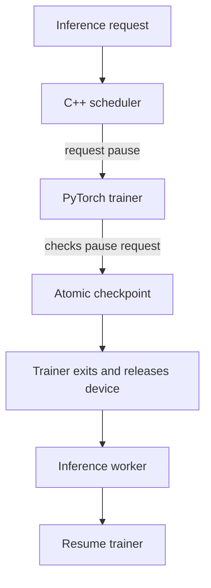

# Checkpoint-Aware GPU Job Scheduler

A Linux/C++ prototype that shortens the wait for small inference jobs by checkpointing a running PyTorch training job, releasing the device, serving queued work, and resuming training from the last committed state.

## Result

Across five controlled runs with two queued inference jobs per run, checkpoint scheduling reduced the median average inference wait from **8.82 s to 4.11 s**, a **52.2% reduction**. Training completed a median **9.10 s later** because the prototype paid for checkpointing, process startup, inference, and restart.

| Metric | FCFS | Checkpoint policy |
|---|---:|---:|
| Median average short-job wait | 8.82 s | 4.11 s |
| Median training elapsed time | 5.16 s | 14.27 s |
| Median wait reduction | - | 52.2% |

These figures come from a controlled synthetic workload with paced training steps. They demonstrate the scheduling mechanism and its trade-off. They do not represent production model throughput.

## Architecture



The checkpoint stores the model, optimizer, and completed step. It is written to `pending.pt` and atomically renamed to `checkpoint.pt`, so an incomplete write does not replace the previous committed checkpoint.

## Fastest way to reproduce

1. Open Google Colab.
2. Upload `notebooks/Checkpoint_Scheduler.ipynb` and run all cells. Confirm that resumed weights match uninterrupted training.
3. Upload `notebooks/Queue_Benchmark.ipynb` and run all cells on a T4 GPU or CPU runtime.
4. Confirm `PASS: both queued jobs ran and final weights match.`
5. Download the generated `results.json`.

No local installation is required for the notebook workflow.

## Local build

Requirements are Linux, Python 3.10+, a C++17 compiler, and PyTorch.

```bash
python3 -m venv .venv
source .venv/bin/activate
pip install -r requirements.txt
make
mkdir -p queue
./scheduler checkpoint
```

The benchmark notebooks provide the complete controlled experiment. The command-line source is included for inspection and extension.

## Repository layout

- `src/scheduler.cpp` contains the Linux process scheduler.
- `src/worker.py` contains checkpointable training and short inference workers.
- `notebooks/` contains the correctness demo and queue benchmark.
- `results/runs/` contains the five supplied benchmark runs.
- `results/summary.csv` and `results/summary.json` contain the aggregate analysis.
- `scripts/summarize_results.py` reproduces the summary from the run files.
- `tests/test_results.py` validates the stored benchmark files and reported medians.
- `docs/PROJECT_REPORT.pdf` is a printable project report.

## Correctness properties demonstrated

- A training worker saves model and optimizer state before releasing the resource.
- Resumed training reaches weights equal to an uninterrupted reference within PyTorch tolerance.
- Both queued short jobs execute under both policies.
- Every supplied run shows a lower average short-job wait under checkpoint scheduling.
- Checkpoints are committed using an atomic rename.

## Current scope

This prototype uses a filesystem queue and cooperative workers. A production version would add Unix-domain socket submissions, per-user fairness, authentication, durable job metadata, cancellation, GPU-memory verification, multiple devices, failure recovery, and measurements on real training and inference workloads.

## Resume-ready description

Built a C++/Linux checkpoint-aware GPU scheduler that coordinates PyTorch workers using processes and filesystem signals. Verified restart correctness against uninterrupted training and reduced median inference-job wait by 52.2% across five controlled runs, while quantifying the training-completion trade-off.

## License

MIT License. See `LICENSE`.
